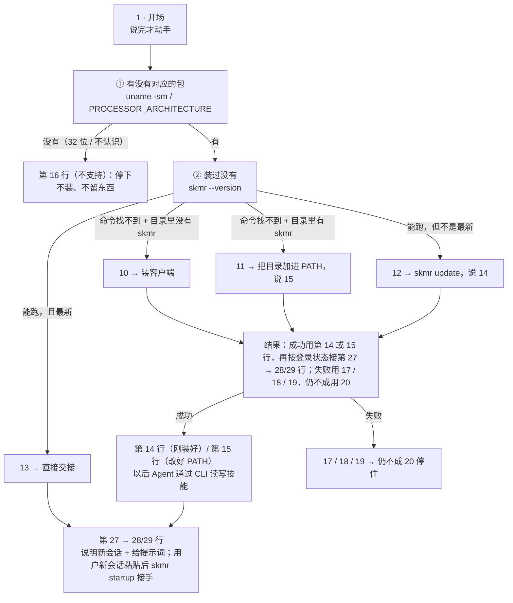

# 安装路径（已退役的历史流程图）

> **v84 起这份图不再维护。** 安装页改成写给安装的人：步骤由用户在自己的终端执行；Agent 只在用户明确要求时按页面执行，并遵守停止规则。下面的「第 N 行」指已删除的话术表，只作历史参考。
>
> **这是什么（历史）**：`skillmaster-site/install/skillmaster.md.in` 的旧结构图——每一步用话术表的第几行、agent 做什么、在哪儿停。
> **终点在哪**：**CLI 能跑就算装完**。装好之后交给**新会话**：安装说明先说明技能要新会话才生效，再给一句提示词；用户在新会话粘贴后，`skmr startup` 接手。安装说明不替它开头。
> **权威在哪**：安装页本身。这份图只作历史参考，不再与它对齐。

## 一张图

## 每一步：用哪一行、自己做什么

| 步骤 | 用哪一行 | agent 做什么 | 停在哪 |
|---|---|---|---|
| **开场** | 1 | 说完**才**跑检查 | — |
| **① 有没有包** | 不支持 → 16 | `uname -sm`；Windows 看 `PROCESSOR_ARCHITEW6432` → `PROCESSOR_ARCHITECTURE` | **停**，不装、不留东西 |
| **② 装过没有** | 没装过 → 10／装过找不到 → 11／旧了 → 12／最新 → 13 | `skmr --version`；找不到时再看默认目录里有没有 `skmr` | — |
| **装（没装过）** | 10 之后直接装 | 跑安装命令（不问、不播报） | 见附录 A |
| **改 PATH（装过找不到）** | 11 之后直接改；说 15 | 把默认目录持久地加进 shell 配置，**新开终端** | 改不动就继续用绝对路径；真跑不起来用 26 停住 |
| **更新（旧了）** | 12 之后直接更新；说 14 | `skmr update` | 见附录 A |
| **刚装好 / 刚更新** | 14，然后 27 → 28/29 | 确认 `skmr --version` 打印出版本与提交号；`skmr auth status` 看登录 | 跑不起来 → 用 26 停住 |
| **改好 PATH，新开终端** | 15，然后 27 → 28/29 | 先说明新会话、交提示词；**安装会话不跑 `startup`** | 跑不起来 → 用 26 停住 |
| **本来就最新** | 13，然后 27 → 28/29；**不再说 14** | 先说明新会话、交提示词；**安装会话不跑 `startup`** | 这次什么都没装，不能说「装好了」 |
| **交接** | 13 / 14 / 15 挑一句开头，再按登录状态接 27 → 28/29 | 先说明新会话、交提示词；不解释后面的步骤 | 交给新会话里的旅程 |
| **云端 / 远程** | 30 | 识别出每会话新环境就不交棒 | 说第 30 行，停 |

**没登录时**：第 5 步的退出码 1 / 4 分支先跑 `skmr login`（或 API key），拿到凭据后回到第 27 → 28/29；云端 / 远程 Agent 每开一个会话就是新环境，说第 30 行、停。

## 两个平台不一样的地方

| | macOS / Linux | Windows |
|---|---|---|
| 安装目录 | `~/.local/bin` | `%LOCALAPPDATA%\SkillMaster\bin` |
| 架构 | `uname -m` | `PROCESSOR_ARCHITEW6432` → `PROCESSOR_ARCHITECTURE` |
| PATH 生效 | 新终端 / 新 Agent 会话 | 新终端 / 新 Agent 会话 |
| 安装脚本 | `install.sh` | `install.ps1` |

## 装失败时

**每次都要先说清：这次什么都没装成，你电脑上原来的东西没被动过。**

| 脚本说什么 | 用哪一行 | 接下来 |
|---|---|---|
| 下载失败 / `Connection reset by peer` / 连不上 | 17 | 重试一次，再失败用 20 停住 |
| `建不了安装目录` / `复制失败` | 18 | 换一个可写目录再装，仍失败用 20 |
| `校验和不符` | 19 | 重试一次，仍失败用 20 |
| `不支持的系统` / `认不出架构` | 16 | 这台机器装不了，停下 |

**不许为了让它「成功」绕开校验和、换来源，或把失败说成成功。**

## 三条不变的规则

1. **不问、不播报**：用户把「开始」那句发过来就是同意，装、更新、改位置之前不再问；过程中也不报「正在下载」。开场那句仍最先说。**`startup` 旅程同样照这条办**：清单里挑了哪几项就是同意了那几项，写说明、传技能、上线、备份都不再逐步请示；只有三处要问，且每处都带推荐——同名技能留哪份、文件里已有的写法换不换、本机那份清不清（清之前先备份）。
2. **停下要说清三件**：停在哪一步、什么都没变（原来的东西没被动过）、以后怎么继续。
3. **技术词不进口语**：路径、命令、`PATH`、TLS 都不出现在对用户说的话里。
